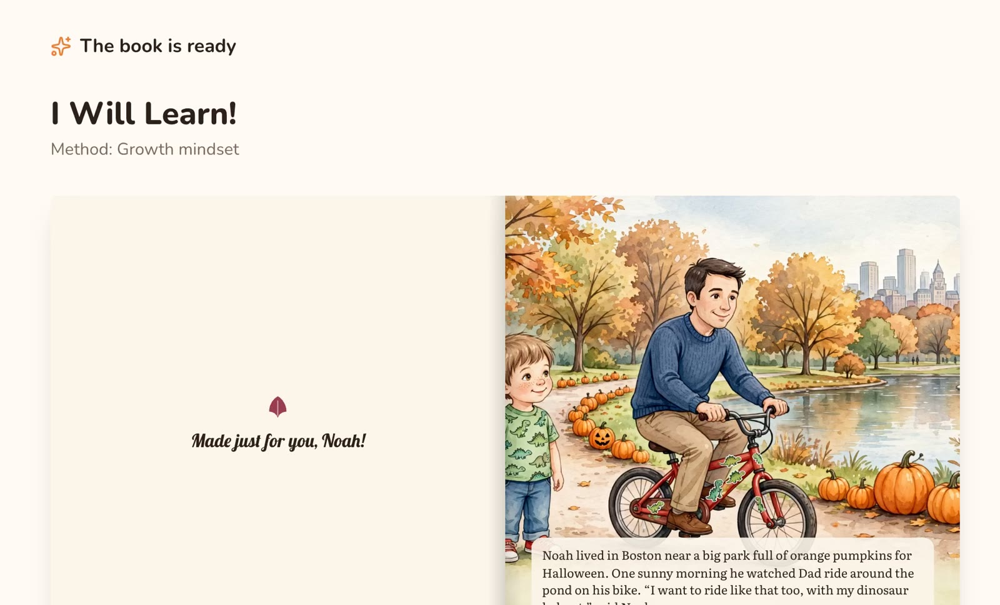
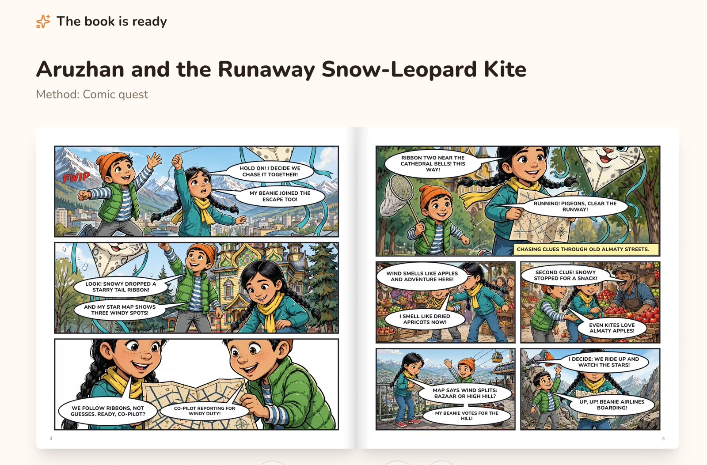
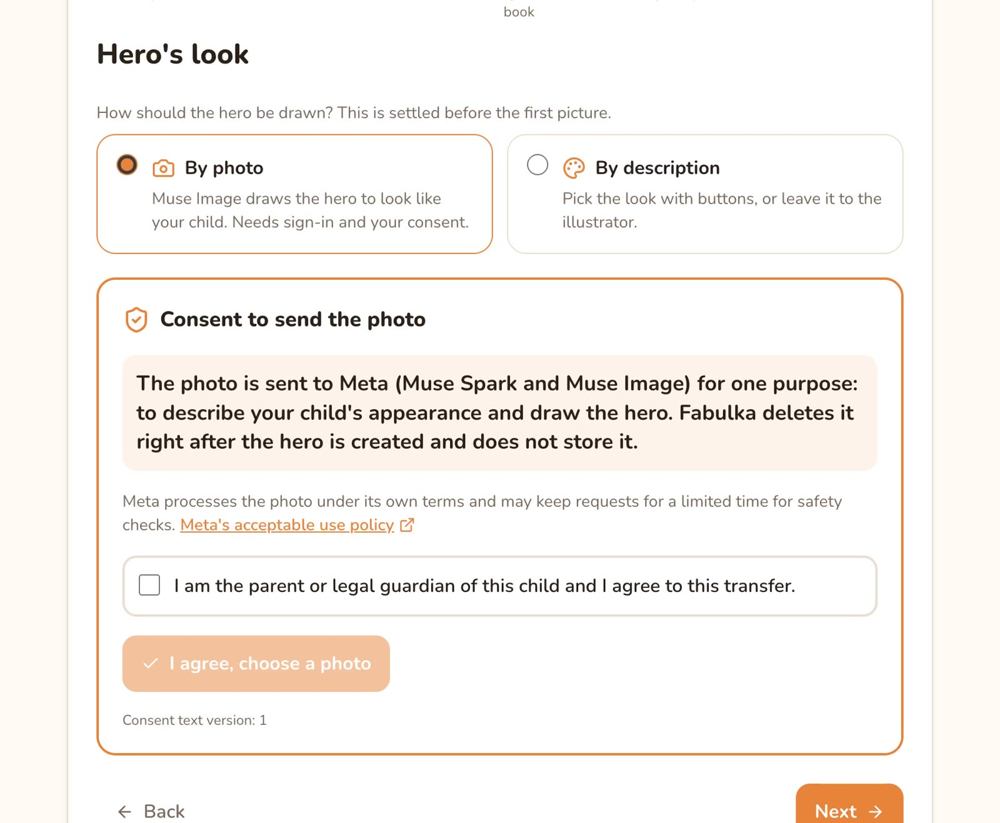
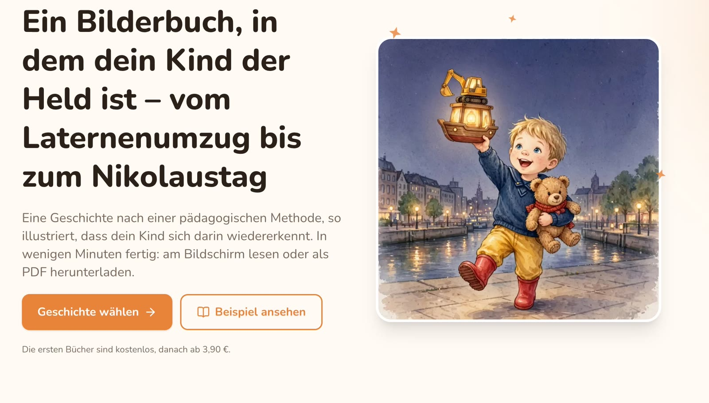
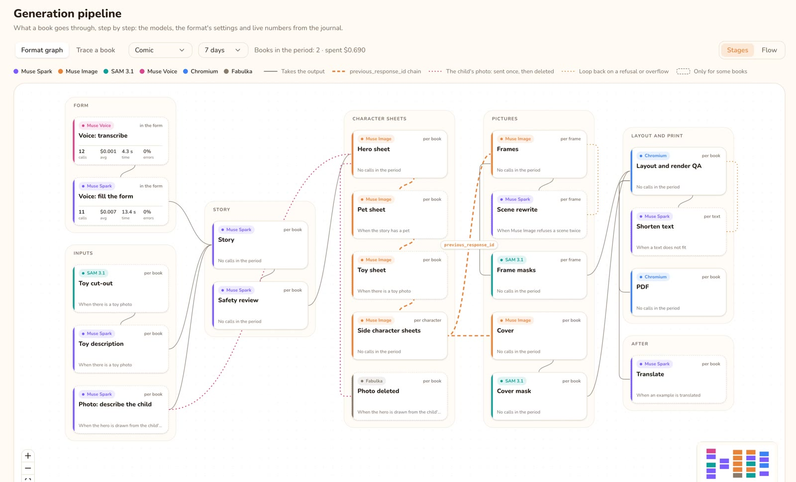
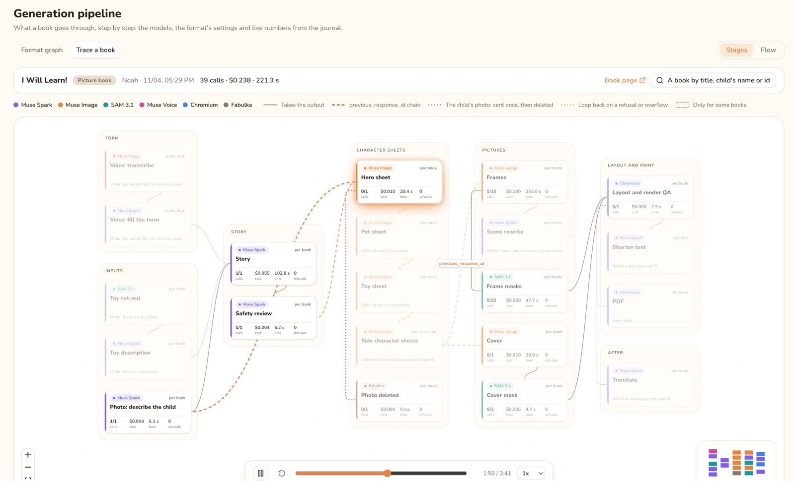

# Fabulka

**Every parent can be an author.** A parent tells about their child out loud, adds a photo of the child
(only with explicit consent) and a photo of a favourite toy, and Fabulka makes a fully illustrated
picture book (or a comic for older kids) where the child is the hero: in their own language, built on
child-development methods, ready to read tonight or to print.

- **Live:** https://fabulka.com
- **Demo video (3 min):** https://youtu.be/j1EmJoYvrhY
- **Hackathon:** Meta Global AI Developer Hackathon, Indie track, "Build for Your World"

<p>
  
  
</p>

## For judges: where to look

| Criterion | Where it shows |
| --- | --- |
| Impact | Kids read for fun less than ever, and most never see themselves in a book in their own language. Fabulka is live in five languages and nine launch countries (KZ, US, CA, MY, AU, DE, AT, CH, ES), each with local heroes, holidays, prices and a print partner. |
| Use of Meta AI tooling | Four Meta models in one chain of about 30-40 calls per book: [How Fabulka uses Meta models](#how-fabulka-uses-meta-models). Things beyond a basic integration: `previous_response_id` chaining for one consistent hero, SAM masks as layout data, Spark rewriting only the scene the image filter refused. |
| Technical depth | Book formats are data (pages of frames and texts), so a comic is a second format, not a second codebase; a pipeline graph per format with live numbers from the call journal; 64 E2E flows in CI. |
| Demo | The video above is the real product on real models; the site is live, and every book can be traced call by call in the admin. |

## Built from scratch during the hackathon

Everything in this repository was written during the building period (Oct 27 - Nov 4, 2026). Before it
there was only an idea. The repository was created on **Oct 28, 2026** with an empty scaffold
([first commit `2be7c7e`](https://github.com/baibesh/fabulka/commit/2be7c7e)), and the full history is
public: `git log --reverse`. No code, designs or assets from earlier projects were reused.

| Day | Commits | What was built |
| --- | --- | --- |
| Oct 28 | 3 | Empty monorepo (Next.js + NestJS + shared zod), mock models, CI with E2E from the first commit |
| Oct 29 | 1 | CI fixes for the test runner |
| Oct 30 | 26 | The core: Muse Spark stories by child-development methods, Muse Image character sheets and pages chained for consistency, SAM 3.1 toy cut-out, PDF, page-turning reader, catalog, admin, Docker deploy, geo policy, the name **Fabulka** |
| Oct 31 | 11 | Landing, sign-in (Keycloak), accounts, order emails, voice input (Muse Voice Transcribe), journal of every model call |
| Nov 1 | 45 | Admin-managed methods, prices, cities and countries; Spanish and German; a UI kit; book themes proposed by Muse Spark and checked in code; layouts chosen from SAM masks with render QA; print formats; photo page |
| Nov 2 | 18 | Per-language samples, language in the URL (EN default), country by IP, admin SEO section with publish and history |
| Nov 3 | 38 | Examples as stories with language versions (translated by Muse Spark, same illustrations), staff roles and country managers, audit log and spend caps, multi-currency money, refusal-proof generation, a live generation screen, designed covers with SAM-placed lettering, illustrator references |
| Nov 4 | 39 | Nine launch countries with local content; book formats as data with comics as the second format; the child's photo as the hero reference by consent (deleted right after the hero sheet, consent text versioned in the admin); comic balloons kept off faces with SAM; admin workspaces per country with an Inbox and Cmd+K; the Pipeline graph with a book trace and replay; a hand theme editor; CI E2E in four shards |

Third-party tools used, not built here: Keycloak (sign-in), Postgres, Next.js, NestJS, Prisma, React Flow,
and [tapstep](https://tapstep.dev), the author's own earlier E2E testing tool, used only to test Fabulka.
The demo video was edited in After Effects; its voice-over (Gemini TTS) and the two family scenes at the
end (Gemini Omni, labelled "Concept") are the only non-Meta AI in the submission, and none of it is in
the product. The child's photo in the demo is AI-generated (Muse Image), not a real child.

## How Fabulka uses Meta models

One book is a chain of about 25-40 calls to four Meta models. Each call is logged with its cost and
latency in the admin journal (`ModelCall`).

| Step | Model | What it does |
| --- | --- | --- |
| Voice | Muse Voice Transcribe | The parent tells about the child out loud, in any of five languages. |
| Form | Muse Spark | Turns the transcript into the child's profile (name, age, interests, pet, city). |
| Child's photo | Muse Spark vision + Muse Image | Only with the guardian's consent: Spark describes the child's look, and the photo is sent to Muse Image once as the reference for the hero sheet, then deleted from storage. Without a photo the parent picks the look with buttons. |
| Toy | SAM 3.1 + Muse Spark vision | SAM cuts the favourite toy out of the parent's photo; Spark describes it for the story and the illustrator. |
| Story | Muse Spark | Writes the book as strict JSON by a child-development method and age norms: title, hero description, pages (or comic frames with captions, speech balloons and sound words) with scene and the method's beat, cover scene, blurb, questions to talk about after reading. |
| Review | Muse Spark | Reads the story as a children's content reviewer before anything is drawn. |
| Characters | Muse Image | Character sheets for the hero, the pet and the toy (the cut-out as a reference), chained with `previous_response_id`. |
| Pages and cover | Muse Image | Every page or comic frame and the cover chain from the sheets, so the child looks the same everywhere; illustrator style references and beat composition sketches ride along as `input_image`. Pages render in parallel. |
| Refusals | Muse Spark | If the image safety filter refuses a page, the scene is softened; if refused again, Spark rewrites that one scene safely; the book always finishes. |
| Layout | SAM 3.1 | Finds the characters on each picture, so page text, comic balloons and the child's name on the cover never cover a face. |
| Fit | Muse Spark | Render QA measures every page in Chromium; a page that overflows is shortened by Spark. |
| Languages | Muse Spark | Translates a finished book into another language with the same illustrations and the child's name in the target script. |
| Themes | Muse Spark | Proposes new book themes (fonts, colours, ornaments) that the code then checks for contrast and glyph coverage. |

A 10-page picture book takes about 3 minutes and $0.20-0.25 of model spend (the book in the demo: 39 calls, $0.238, 221 s). `MODELS=mock` swaps every call
for canned output, so tests and CI never call the API.

## The product

<p>
  
  
</p>

- **Catalog and own stories.** Ready books by method (first day at kindergarten, "I can't do it yet",
  big feelings, bath time, adventure) or a story of your own, ages 2-12.
- **Picture books and comics from one engine.** A book format is data: pages made of frames, each with
  the kinds of text it carries (narration, caption, speech balloon, sound word) and word limits. The comic
  is the second format, added without a second pipeline.
- **The child's photo, by consent.** The guardian ticks a consent box whose text is edited and
  versioned in the admin; the photo goes to Meta once and is deleted right after the hero sheet.
- **Five languages, launching country by country.** English (default, unprefixed URLs), Kazakh, Russian,
  Spanish, German; prices in the country's currency; print where a local partner exists.
- **Live generation screen.** Every step with the model doing it, the hero and pages appearing as they
  are drawn, an honest time estimate.
- **Print-ready books.** Designed cover with the child's name lettered in, back cover, spine and wrap
  for soft and hard covers, print formats per country.
- **A studio to scale it.** Methods, formats, themes and illustrator references are edited in the admin.
  The Pipeline page draws each format as a graph of model calls with live numbers from the journal, and
  traces any real book call by call with a replay.
- **Admin for a global team.** A Global workspace and one per country, each opening on an Inbox of what
  needs attention, with Cmd+K search. Superadmin, country managers (only their countries: prices, delivery,
  cities, landing, examples, orders), SEO staff and illustrators (style references, beat sketches,
  page review); a "what a visitor sees" matrix per country and language; audit log of every change;
  daily model-spend caps per person and country.

<p>
  
  
</p>

## Where it runs and Meta's policies

- **The backend runs in Kazakhstan**, where Meta has enabled the Model API; calls are never routed
  through another country.
- **Restricted countries** from Meta's [Geographic Use Policy](https://dev.meta.ai/legal/geographic-use-policy)
  get HTTP 451 before any model is called (`apps/api/src/geo`, country from the
  [DB-IP](https://db-ip.com) database, CC BY 4.0).
- **Children's data** of Kazakh citizens stays in Kazakhstan, as the local personal data law requires.

## Built to run

- Generation runs in the API, a few books at a time; a restart marks unfinished books failed instead
  of hanging. Spend stops at `MODEL_BUDGET_USD`, plus per-visitor, daily and per-staff caps.
- Money is integer minor units with a currency; orders snapshot their lines and exchange rate.
- Prisma migrations; CI runs typecheck, lint, unit tests and 64 E2E flows (four parallel shards)
  against Postgres with mock models, and only then builds the images.

## Stack

- `apps/web`: Next.js 16, Tailwind 4, TanStack Query, react-hook-form + zod
- `apps/api`: NestJS 11, Prisma + Postgres, OpenAI SDK pointed at `https://api.meta.ai/v1`
- `packages/shared`: zod schemas, layout engine and types shared by web and API
- `e2e`: tapstep flows: UI, HTTP and SQL checks in one YAML

## Run locally

Needs Node 22+, pnpm and Postgres.

```bash
pnpm install
createdb fabulka
cp apps/api/.env.example apps/api/.env   # set DATABASE_URL; MODELS=meta + MODEL_API_KEY for real models
pnpm --filter @fabulka/api exec prisma migrate deploy
pnpm dev                                  # web :3000, api :4000
```

## Tests

```bash
pnpm typecheck && pnpm lint && pnpm test   # unit tests
createdb fabulka_e2e && cp e2e/.env.example e2e/.env
pnpm build && DATABASE_URL=… ./e2e/start-stack.sh
tapstep test e2e/flows --config e2e/config.yaml --browser managed
```
